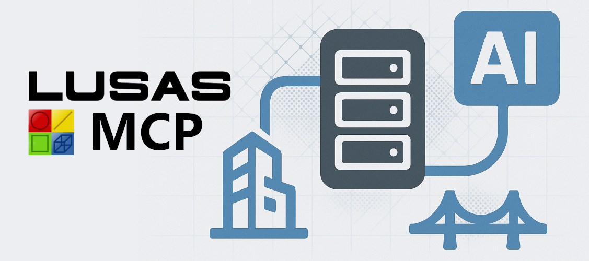

[](https://github.com/LUSAS-Software/LUSAS-MCP-Server/releases/latest)
[](./LICENSE.md)


# LUSAS MCP Server

**LUSAS MCP Server connects AI assistants to [LUSAS](https://www.lusas.com/)** for AI-assisted structural and civil finite element analysis. Engineers can inspect active models, search LUSAS documentation and libraries, generate LPython (LUSAS Python) automation, run workflows, and extract engineering results.

**AI-assisted. Engineer-reviewed. LUSAS-connected.**

The server exposes a compact set of direct MCP tools for connection/model inspection, library lookups, reference search, and LUSAS code execution (through the API, aka LPI, LUSAS Programmable Interface).
## Capabilities

Use an AI client with an open LUSAS model to:

- **Understand the model:** inspect its geometry, attributes, assignments, analyses, loadsets, groups, and connection status.
- **Find authoritative LUSAS knowledge:** search manuals, LPI commands, LPI examples, elements, material libraries, and section libraries for suitable modelling approaches.
- **Automate structural FEA workflows:** generate LPython to create or modify geometry, attributes, loads, assignments, and analyses when LUSAS Code Interaction is enabled.
- **Run and review analyses:** execute LUSAS workflows, read returned logs, and extract requested results such as reactions, displacements, stresses, buckling data, or modal results.
- **Produce model-specific outputs:** create tailored LUSAS scripts, reporting utilities, and result exports for the active model.
- **Inspect safely:** use `read_only_mode` to expose model inspection and knowledge-discovery tools without allowing model changes.

## Requirements

- Python 3.10 or later.
- Python packages from `requirements.txt` (if MCPB package is not used).
- Windows, a compatible installed version of LUSAS, and a valid LUSAS licence.
- Interacting with LUSAS requires you to manually open or create a model.

The server will work with the free [evaluation licence](https://www.lusas.com/evaluation/index.html), however the use of a full or [academic](https://www.lusas.com/academic/index.html) licence is recommended. The latest LUSAS installer can be found [at the downloads section](https://www.lusas.com/user_area/download/index.html) of the official website.

## Installation Instructions
Install required python dependencies:
1. Shift right click inside the repository folder and select `Open Powershell window here`
2. Run the command (right click to paste + enter to run):

    `pip install -r requirements.txt`

## Configuration

Server configuration lives in `src/config.json`, which can be edited as a text file:

- Set `lusas.version` to match the installed LUSAS version (e.g. change from "24.0" to "23.0").

- When `read_only_mode` is enabled, the server does not register `LUSAS Code Interaction`, `Load Model Backup`, or the save/close lifecycle tools.

- When `save_generated_scripts` is enabled, executed source, prepared source, and error logs are cached in `LUSAS_MCP_Generated_Scripts` beneath the server working directory.

- Set `log_filepath` to the desired log filename, including its directory. The server creates the parent directory when necessary. An empty value writes `lusas_mcp.log` in the server's working directory.

- Set `allow_manual_images_return` to `true` to return images in `Search Manual` results and to register `Get Manual Image`.

By default, the server loads `src/config.json`. Use `--config-filepath` to load another JSON configuration file:

```powershell
python .\src\server.py --config-filepath C:\path\to\config.json
```


## Connect LUSAS MCP with an AI Client

### Claude Desktop (MCPB Package)

1. Download `lusas-mcp-X.X.X.mcpb` from [releases](https://github.com/LUSAS-Software/LUSAS-MCP-Server/releases/latest).
2. Open `lusas-mcp-X.X.X.mcpb` with Claude Desktop to install the MCP server.
3. Proceed with the installation.
4. The server config can then be found at `%APPDATA%\Claude\Claude Extensions\local.mcpb.lusas.lusas-mcp\src\config.json`.

### Claude Desktop (Manual)

1. Download this repository (through the green `Code` button at the top of the page).
2. Open Claude Desktop, go to `File > Settings > Developer > Edit Config`.
3. Edit `claude_desktop_config.json` (located at `%APPDATA%\Claude\claude_desktop_config.json`) adding:

    ```json
    {
        "mcpServers": {
            "lusas": {
                "command": "python",
                "args": [
                    "C:\\path\\to\\LUSAS-MCP-Server\\src\\server.py"
                ]
            }
        }
    }
    ```
4. Replace `C:\\path\\to\\LUSAS-MCP-Server` with the path to this repository, ensuring `\\` are used between directories.
5. Restart Claude Desktop after editing the config (from the tray icon, right click > Quit).

### OpenAI (aka Codex)

1. Download this repository (through the green `Code` button at the top of the page).
2. Add this to your Codex `config.toml` (located at `%userprofile%\.codex\`):

    ```toml
    [mcp_servers.lusas]
    command = "python"
    args = ["C:\\path\\to\\LUSAS-MCP-Server\\src\\server.py"]
    ```
3. Replace `C:\\path\\to\\LUSAS-MCP-Server` with the path to this repository, ensuring `\\` are used between directories.
4. Restart Codex.

### OpenCode

1. Download this repository (through the green `Code` button at the top of the page).
2. Add this to your `opencode.jsonc` (located at `%userprofile%\.config\opencode\`):

    ```json
    {
        "mcp": {
            "lusas": {
                "type": "local",
                "command": ["python", "C:\\path\\to\\LUSAS-MCP-Server\\src\\server.py"],
                "enabled": true
            }
        }
    }
    ```
3. Replace `C:\\path\\to\\LUSAS-MCP-Server` with the path to this repository, ensure `\\` are used between directories.
4. Restart OpenCode.

### Visual Studio Code / GitHub Copilot

1. Download this repository (through the green `Code` button at the top of the page).
2. This repository includes `.mcp.json`, which loads the MCP server automatically when the MCP server repository folder is open in VSCode, for use with the integrated assistant.
3. To enable the MCP server globally in VSCode, add this to your `mcp-config.json` (located at `%userprofile%\.copilot\`).
    ```json
    {
        "mcpServers": {
            "lusas-mcp-server": {
                "tools": ["*"],
                "type": "stdio",
                "command": "python",
                "args": ["C:\\path\\to\\LUSAS-MCP-Server\\src\\server.py"]
            }
        }
    }
    ```
4. Replace `C:\\path\\to\\LUSAS-MCP-Server` with the path to this repository, ensure `\\` are used between directories. If the `mcpServers` exists, only add the part within the curly brackets.
5. Restart VSCode.


## Exposed MCP Tools

The current server registers these tools:

| Tool | Purpose |
| --- | --- |
| `Get LUSAS Status` | Check whether LUSAS is reachable, which version is configured, and whether a model is open. |
| `Get Model Overview` | Return a compact overview of the active model, with optional detail flags for attributes, analyses, loadsets, and groups. |
| `Get Model Backups` | List automatic backup files for the active saved model, including creation time when the filesystem provides it. |
| `Load Model Backup` | Close the active model, copy a selected automatic backup beside it without overwriting an existing file, and open the copy. |
| `Save Model` | Save the open model, optionally to a new location. Saving as closes analysis results. |
| `Close Model` | Close the open model, optionally saving first. Unsaved changes are otherwise lost. |
| `Close LUSAS` | Close LUSAS after the open model has been saved or closed. |
| `LUSAS Code Interaction` | Execute LPython in LUSAS. |
| `Search Section Libraries` | Free-text search across active-model library name, section type, and section name (for example `UK RHS 500x200x8`). |
| `Search LPI commands` | Search compact LPI command metadata by keyword. |
| `Get LPI Command Details` | Retrieve complete documentation for the selected LPI command IDs. |
| `Search LPI Examples` | Search compact bundled example metadata in the language supported by the configured LUSAS version. |
| `Get LPI Example` | Retrieve one selected bundled example's source code. |
| `Search Materials Library` | Free-text search across bundled material, region, standard, and grade metadata (for example `concrete Europe C40/50`). |
| `Search Elements` | Search supported LUSAS element names by query, family, feature type, and stress variation. |
| `Get Element Details` | Retrieve the complete metadata for one or more exact element names. |
| `Search Manual` | Search the extracted LUSAS manual index. |
| `Get Manual Entries By TOC Path` | Retrieve manual entries by exact or prefix `toc_path` values. |
| `Get Manual Image` | Return native MCP image content for an image ID from a manual search result. |

`LUSAS Code Interaction`, `Load Model Backup`, and the save/close lifecycle tools are registered only when `read_only_mode` is disabled (see Configuration). `Get Manual Image` is registered only when `allow_manual_images_return` is enabled.


## MCP Resources

The server currently exposes:

| Resource | Purpose |
| --- | --- |
| `config://app` | Current server configuration. |
| `lusas://lpi/{identifier}` | Complete documentation for one LPI command ID. |
| `lusas://examples/index` | Compact metadata index for all bundled LPI examples. |
| `lusas://examples/{identifier}` | Complete bundled LPI example in the configured language. |
| `lusas://sections/index` | Available active-model section-library categories. |
| `lusas://sections/{library}` | Available section types for one library category. |
| `lusas://sections/{library}/{section_type}` | All section names for one library and section type. |


## Safety, privacy, and engineering responsibility

**Data and privacy:** Information returned by this server can be included in the context sent to the connected AI service. That information is processed under the policy of the AI service you choose. Do not share information unless you are authorised to do so and its handling is appropriate for your project.

**Engineering-use notice:** This software helps AI assistants create or alter models and produce outputs or results. You are responsible for confirming that an AI response is suitable for your project and for independently checking all models, assumptions, inputs, outputs, and results through appropriately qualified professional review before relying on them.
